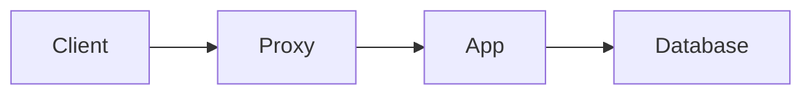

# Video Learning

Use this skill when turning any video into vault memory — backend, frontend, product, or general learning.

## Goal

Turn videos into learnable wiki memory, not passive summaries. Raw is source-of-truth, lesson teaches from zero with no loss.

## Vault Paths

- Raw transcripts: `raw/sources/<course>/` (e.g. `backend-engineering/`, `general/`)
- Course notes: `wiki/courses/<course>/` (e.g. `backend-engineering/`, `frontend/`)
- Durable concepts: `wiki/concepts/` (living, append per-project/per-video)
- Update every ingest: `wiki/Index.md` and `wiki/Log.md`

## Per-Video Workflow

1. Capture metadata and transcript.
   - Prefer YouTube captions via `yt-dlp --skip-download --write-auto-subs --sub-langs en`.
   - Verify caption quality: check URL/speaker/date, spot-check 30s vs audio; if low confidence note `transcript_type: auto (unverified)` in frontmatter.
   - Save cleaned transcript as `raw/sources/<course>/NN-slug-transcript.txt` (e.g. `backend-engineering/` or new course folder).
2. Create one course note under `wiki/courses/<course>/` (match raw folder).
3. Add or update **living** concept pages for reusable ideas in `wiki/concepts/`.
   - If `wiki/concepts/<Topic>.md` doesn't exist → create it (what it is + minimal example + when to use).
   - If it exists → append new evidence/usage, don't overwrite. Keep per-project or per-source subsections so the page grows (e.g. `### MechFlow — zod/mini via ROP`).
   - If topic is entirely new (e.g. not backend), create a new folder `wiki/courses/<new-course>/` or `wiki/concepts/<NewTopic>/` and note it in the log.
4. Add backlinks using Obsidian `[[double brackets]]`.
5. Update `wiki/Index.md` and append to `wiki/Log.md`.

## Learning-First Note Template

Every video note is a **full lesson from raw** — adaptive depth: short/low-value videos get a 5-bullet summary, core/durable videos get the full 10-section lesson (don't overproduce). Raw is source-of-truth; lesson is the video as a readable course. Coverage is draft until verified.

Use this template (keep recall short and separate in Backend Recall Journal):

```markdown
---
tags: [course, backend-engineering]
created: YYYY-MM-DD
updated: YYYY-MM-DD
status: seed
source_count: 1
sources:
  - raw/sources/backend-engineering/NN-slug-transcript.txt
---

# Lesson Title
> Source: raw/...-transcript.txt — full talk preserved there, this is the teach-from-zero version.

## 1. Why This Matters
One-sentence hook: what real problem this solves.

## 2. Prerequisites
What to know first: [[Link]]

## 3. What It Is — From Zero
Plain English + analogy, then formal definition.

## 4. How It Works — Deep Dive
Step-by-step from video, keep its stories/examples distilled (not verbatim transcript).
One Mermaid per mechanism.

## 5. Video's Core Examples
Bank transfer / Instagram likes etc. — keep narrative, with tables.

## 6. Levels / Variations / Tradeoffs
Table for isolation levels, etc.

## 7. Common Pitfalls
What learners get wrong.

## 8. Real-Life Usage — Our Projects
MechFlow: how we use it (link living [[Concept]]). Other projects append here.

## 9. TL;DR + Recall
3 bullets + 3 recall Qs (answer in Backend Recall Journal)

## 10. Practice & Connections
Exercises + links to next lesson + living concepts

## Raw Reference
Full talk in raw/...-transcript.txt
```

## Visual Rules

Use visuals whenever the topic is flow-shaped or layered:

- request/response paths;
- TCP/UDP and protocol stacks;
- proxy vs reverse proxy;
- cache layers;
- queue/pub-sub flow;
- database index/search flow;
- TLS handshake;
- DNS/TCP/TLS/HTTP browser journey.

Prefer simple Mermaid diagrams:



Do not over-diagram plain definitions.

## Code Handling — Illustrative When Needed

Most backend videos teach visually/verbally, not via verbatim code in captions. Follow the vault rule from [[Rules]]: *prefer a small code-shaped example when it clarifies; if source is only visual/verbal, add clearly labeled pseudocode/skeleton rather than pretending source had full code.*

### Code Extraction (when video shows code)

1. First check transcript for spoken code/commands.
2. If insufficient, download video or sample frames only when needed.
3. Extract screenshots around code-heavy moments with `ffmpeg`.
4. OCR/manual read to reconstruct minimal examples.
5. Mark as `// reconstructed from screen — not verbatim transcript`.

### Illustrative Examples (when no code visible but concept is code-facing)

Create a **minimal illustrative** snippet that teaches the idea. Mark clearly:

```ts
// illustrative — not verbatim from video, teaches the concept
```

Keep it tiny (one schema, one query, one handler), runnable or pseudocode, no full app. Every code-facing lesson should have at least one such snippet in §4 or §5 so the learner can see the idea, not just read about it. If lesson is non-code (career, process), skip code.

Use the shortest useful example; no full app unless video is a full build.

## Learning Guidance

For learners, add:

- recommended order;
- mental model;
- recall questions;
- one tiny exercise;
- when to revisit the raw transcript.

The best value loop is:

1. Read Big Idea and Mental Model.
2. Try Recall Questions before reading details.
3. Read Key Concepts.
4. Do the tiny Practice task.
5. Write answers in `wiki/courses/backend-engineering/Backend Recall Journal.md`.
6. Ask AI to correct wrong ideas, improve wording, and add one missing connection.
7. Move remaining confusion to `wiki/courses/backend-engineering/Backend Open Questions.md`.
