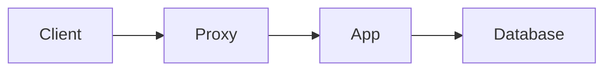

# Video Learning

Vault path: discover the Metonia vault by reading the `METONIA_VAULT`
environment variable, or by asking the user for the path. There is no
machine-specific fallback.

Use this skill when turning any video into vault memory — backend, frontend,
product, or general learning.

## Goal

Turn videos into learnable wiki memory, not passive summaries. Raw is
source-of-truth; the lesson teaches from zero with no loss.

## Workflow Class and Ownership

This is an Obsidian/vault learning workflow, not a coding workflow. Do not
create a work-project plan or invoke the coding planner → executor → reviewer
chain merely because a video teaches code.

Use one vault writer. A short, clean transcript can use Luna/medium for the
complete ingest. Prefer Terra/medium for a long, dense, highly technical, or
low-confidence transcript. Use Luna/low only for bounded metadata, caption, or
source lookup. Independent review is optional unless the user requests
publication-grade accuracy; transcript confidence, source links, and spot
checks are the default evidence.

### Pi orchestration

In a parent session with the `subagent` tool, classify the transcript before
vault writes and launch exactly one fresh `worker`. Explicitly inject
`video-learning` because the builtin worker does not inherit skills. Use
`openai-codex/gpt-5.6-luna:medium` only for a short, clean, high-confidence
transcript; otherwise use `openai-codex/gpt-5.6-terra:medium`. Uncertain
classification goes to Terra. When this skill is injected into the worker,
ingest directly and do not delegate again.

```js
{
  workflowScript: `return runs.run("ingest", {
    agent: "worker",
    task: "Load and follow video-learning. Ingest <VIDEO_OR_TRANSCRIPT> into the Metonia vault at <VAULT_PATH>. Preserve transcript evidence, write one lesson, update living concepts and required navigation/log files, then report changed files and transcript spot checks.",
    acceptance: {
      level: "checked",
      criteria: ["Transcript evidence is preserved and the lesson is linked to its concepts"],
      evidence: ["changed-files", "source-url", "transcript-confidence", "spot-checks"]
    }
  })`,
  skill: "video-learning",
  model: "openai-codex/gpt-5.6-luna:medium",
  context: "fresh",
  cwd: "<VAULT_PATH>",
  async: false
}
```

Replace the shown Luna model with `openai-codex/gpt-5.6-terra:medium` for the
Terra route; do not add a separate workflow `thinking` field.

If the `subagent` tool is unavailable, run in the current session and report
the routing exception. A bounded metadata/caption lookup may use
`researcher`/Luna-low before the writer, but it must not mutate the vault or
become a coding review chain.

The `pi-skills` repository is the canonical Pi-specific source and
`~/.pi/agent/skills` is its installed mirror. Metonia may also ship a
provider-neutral distribution copy for other agents. When Pi discovers both,
use this user-global Pi version and do not edit the distribution copy during an
ingest.

## Vault Paths

- Raw transcripts: `raw/sources/<course>/`
- Course notes: `wiki/courses/<course>/`
- Durable concepts: `wiki/concepts/` (living, append per-project/per-video)
- Navigation: update `wiki/Index.md` for a new, renamed, or moved course route,
  not an ordinary lesson update
- Activity: append `wiki/Log.md` for meaningful ingest; skip no-op/tiny typo,
  formatting, or link-only maintenance

## Per-Video Workflow

1. Capture metadata and transcript.
   - Prefer platform captions via a tool such as
     `yt-dlp --skip-download --write-auto-subs --sub-langs en` (run by the user,
     not a repo dependency).
   - Verify caption quality: check URL/speaker/date, spot-check against audio; if
     low confidence note `transcript_type: auto (unverified)` in frontmatter.
   - Save the cleaned transcript as `raw/sources/<course>/NN-slug-transcript.txt`.
2. Create one course note under `wiki/courses/<course>/` (match the raw folder).
3. Add or update **living** concept pages for reusable ideas in `wiki/concepts/`.
   - If `wiki/concepts/<Topic>.md` doesn't exist → create it (what it is +
     minimal example + when to use).
   - If it exists → append new evidence/usage, don't overwrite. Keep per-project
     or per-source subsections so the page grows.
   - If a topic doesn't fit an existing course, create a new folder
     `wiki/courses/<new-course>/` and note it in the log.
4. Add backlinks using Obsidian `[[double brackets]]`.
5. If this creates, renames, or moves a course route, update `wiki/Index.md`;
   ordinary lesson updates must not churn it. Append to `wiki/Log.md` for
   meaningful ingest; skip no-op/tiny typo, formatting, or link-only
   maintenance.

## Learning-First Note Template

Every video note is a **full lesson from raw** — adaptive depth: short/low-value
videos get a 5-bullet summary, core/durable videos get the full 10-section
lesson (don't overproduce). Raw is source-of-truth; the lesson is the video as a
readable course. Coverage is draft until verified.

Use the shared template at `wiki/courses/_templates/Lesson Template.md` (single
source of truth, also used by `/doc-learning`). Keep recall short and
separate in a course `<Course> Recall Journal` page.

## Visual Rules

Use visuals whenever the topic is flow-shaped or layered — request paths,
protocol stacks, caches, queues, or database flows. Prefer simple Mermaid
diagrams:



Do not over-diagram plain definitions.

## Code Handling — Illustrative When Needed

Most technical videos teach visually/verbally, not via verbatim code in captions.
Prefer a small code-shaped example when it clarifies; if the source is only
visual/verbal, add a clearly labeled pseudocode or language-neutral skeleton
rather than pretending the source contained full production code.

### Code Extraction (when video shows code)

1. First check the transcript for spoken code/commands.
2. If insufficient, capture screenshots around code-heavy moments only when
   needed (e.g. `ffmpeg`), then OCR or read manually to reconstruct minimal
   examples.
3. Mark reconstructed code as `// reconstructed from screen — not verbatim transcript`.

### Illustrative Examples (when no code visible but the concept is code-facing)

Create a **minimal illustrative** snippet that teaches the idea. Mark clearly:

```ts
// illustrative — not verbatim from video, teaches the concept
```

Keep it tiny (one schema, one query, one handler), runnable or pseudocode, no
full app. Every code-facing lesson should have at least one such snippet so the
learner can see the idea. If the lesson is non-code (career, process), skip code.

## Learning Guidance

For learners, add:

- recommended order;
- mental model;
- recall questions;
- one tiny exercise;
- when to revisit the raw transcript.

The best value loop is:

1. Read Big Idea and Mental Model.
2. Try Recall Questions before reading details.
3. Read Key Concepts.
4. Do the tiny Practice task.
5. Write answers in the course's `<Course> Recall Journal` page.
6. Ask the AI to correct wrong ideas, improve wording, and add one missing
   connection.
7. Move remaining confusion to the course's `<Course> Open Questions` page.

## Boundaries

- Never store secrets, tokens, passwords, or private customer data.
- Do not ingest private, paywalled, or unauthorized sources into git without
  the user's explicit permission; ask when unsure.
- Mark auto-extracted/unverified content clearly (`transcript_type: auto`).
